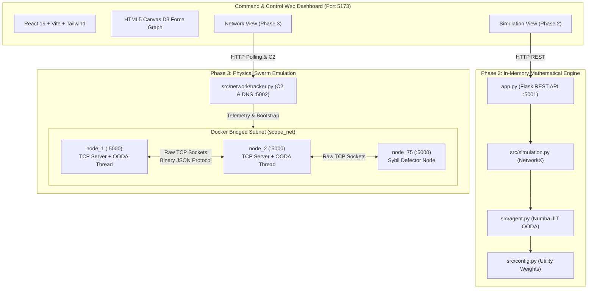

# SCOPE: Strategic Centrality-driven Overlay P2P Evolution


---

## 📌 Executive Overview

**SCOPE** (Strategic Centrality-driven Overlay P2P Evolution) is an advanced decentralized network simulation and physical emulation framework. It models peer-to-peer (P2P) networks as a **Complex Adaptive System (CAS)** where autonomous agents organically self-organize the network into an optimal **Nested Core-Periphery Topology** with zero central coordination.

Unlike traditional static P2P architectures that rely on centralized trackers or suffer from high-latency random-walk flooding, SCOPE equips every node with a cognitive **OODA Loop** (Observe, Orient, Decide, Act) driven by a game-theoretic utility function:
*   **Mathematical Scale (Phase 1 & 2):** In-memory array simulation optimized via Numba LLVM JIT compilation, capable of modeling 50,000+ nodes.
*   **Physical Emulation (Phase 3):** A live **75-container Docker Swarm** communicating over raw localhost TCP sockets using custom binary-prefixed framing, managed via an interactive React Command & Control (C2) dashboard.

---

## 🏗️ System Architecture



---

## 🧭 Repository Navigation Hub

The repository is modularized into dedicated component subsystems and comprehensive documentation guides:

| Component | Directory / File | Description |
| :--- | :--- | :--- |
| **Simulation Engine** | [`src/README.md`](file:///Users/mayankchauhan/Documents/SCOPE/src/README.md) | Phase 1 & 2: Mathematical OODA loops, Numba JIT, NetworkX, and Flask API. |
| **Physical Swarm Engine** | [`src/network/README.md`](file:///Users/mayankchauhan/Documents/SCOPE/src/network/README.md) | Phase 3: 75-node Docker swarm, multi-threaded nodes, raw TCP binary framing. |
| **Web C2 Dashboard** | [`frontend/README.md`](file:///Users/mayankchauhan/Documents/SCOPE/frontend/README.md) | React 19 UI, Vite, Tailwind v4, D3 force-directed physics, node inspector. |
| **Theory & Research Guide** | [`docs/walkthrough_and_theory.md`](file:///Users/mayankchauhan/Documents/SCOPE/docs/walkthrough_and_theory.md) | Deep theoretical walkthrough, mathematical traces, adversarial Sybil dynamics, and paper blueprint. |
| **Project Defense Manual** | [`docs/defense_qna_master.md`](file:///Users/mayankchauhan/Documents/SCOPE/docs/defense_qna_master.md) | 50 comprehensive defense questions with Academic, ELI5, and Follow-up responses. |
| **Presentation & Live Demo** | [`docs/presentation_and_demo.md`](file:///Users/mayankchauhan/Documents/SCOPE/docs/presentation_and_demo.md) | 15-minute presentation guide, screen-by-screen demo script, and paper metrics. |
| **Assessment Report** | [`docs/assessment_report.md`](file:///Users/mayankchauhan/Documents/SCOPE/docs/assessment_report.md) | Academic thesis evaluation of SCOPE as a B.Tech CS Major Project. |
| **Phase 4 & Journal Roadmap** | [`docs/PHASE4_AND_JOURNAL_ROADMAP.md`](file:///Users/mayankchauhan/Documents/SCOPE/docs/PHASE4_AND_JOURNAL_ROADMAP.md) | Phase 4 roadmap, 3-person team parallel division, journal submission plan. |
| **Bilingual Prep Notes** | [`docs/hinglish/`](file:///Users/mayankchauhan/Documents/SCOPE/docs/hinglish) | Hinglish demo script and panel defense preparation materials. |

---

## 🚀 Quick Start Guide

### 1. Launch the Physical Docker Swarm (Phase 3)
Ensure Docker Desktop is running on your machine:
```bash
# Build and boot 1 Tracker container + 75 Peer containers:
docker compose up -d --build --force-recreate

# Verify container status:
docker compose ps
```

### 2. Launch the Interactive React Web Dashboard
Open a new terminal window:
```bash
cd frontend
npm install
npm run dev
```
Open **`http://localhost:5173`** in your browser.
*   Navigate to **Network Dashboard** (`/network`) to inspect live TCP sockets, trigger P2P file transfers, kill nodes to test churn, or toggle Sybil defectors.

### 3. Run the Mathematical Simulation Offline (Phase 2)
To run the in-memory array simulation and generate publication-ready plots (`scope_results.png`):
```bash
pip install -r requirements.txt
python main.py
```
To serve Phase 2 metrics to the dashboard's **Simulation View** (`/simulation`), run:
```bash
python app.py
# Serves Flask REST API on http://localhost:5001
```

---

## 🧠 Core Discoveries & Quantitative Benchmarks

### 1. Emergence of the Core-Periphery Structure
Autonomous agents maximizing the game-theoretic utility function:
$$U_j = \alpha \cdot \ln(1 + k_j) - \beta \cdot \left(\frac{k_i}{10}\right) + \gamma \cdot S_{ij}$$
*   **Average Path Length (APL):** Decreased from **5.08 hops down to 2.65 hops** (-47.8%).
*   **Clustering Coefficient:** Increased from **0.0079 to 0.3931** (+4,875%), forming tight social periphery clusters around high-degree core hubs.
*   **Search Hops (Gradient Ascent):** Reduced from **10.13 hops down to 2.91 hops** (-71.3%).
*   **Search Success Rate:** Rose from **26.2% to 73.4%** (~2.8× increase).

### 2. Solving the Free-Rider Problem (Differential Service)
To prevent nodes from consuming bandwidth without maintaining connections, SCOPE enforces a **Logistic Bandwidth Curve**:
$$\text{Bandwidth}(k_i) = \frac{100}{1 + e^{-0.5 \cdot (k_i - 10)}}$$
Core Hubs maintaining 60+ connections are rewarded with **100 Mbps**, while free-riding leaf nodes with 2 connections are throttled to **~1.79 Mbps** (**27.9× incentive multiplier**).

### 3. The "Dead-End Phenomenon" in Greedy Routing
During physical file transfers, routing purely by Gradient Ascent caused packets to get trapped inside dense clusters of Super-Hubs. Once all local hub neighbors were visited, packets hit a **`FAILED_DEADEND`**. SCOPE resolved this by introducing 2-hop gossip memory caching (`self.memory`), allowing packets to bypass local maxima and jump directly across clusters.

### 4. Adversarial Resilience: The "Black Hole" Sybil Attack
Injecting 10 malicious Defectors into the 75-node swarm revealed a key vulnerability: defectors spoofed their degree telemetry ($k_{\text{fake}} = 3k + 5$). Honest nodes eagerly connected to them, turning defectors into central topological hubs that silently dropped **24.29% of all routed traffic** (1,214 of 4,997 packets dropped). This proved that purely topological utility functions must be augmented with cryptographic Proof of Throughput ($\delta$).

---

## 🛠️ Dynamic Swarm Orchestration Commands

```bash
# Dynamically scale swarm to 100 containers without dropping existing connections:
docker compose up -d --scale node=85 --scale defector=15 --no-recreate

# View live registration & heartbeat activity on the tracker:
docker compose logs -f tracker

# View individual container OODA loop decisions:
docker compose logs -f node_1

# Tear down the swarm cleanly:
docker compose down -v
```

---

## 📄 License & Attribution
This project is licensed under the MIT License. Developed as a final-year B.Tech Computer Science Major Project and Undergraduate Research Thesis on Complex Adaptive Systems and Decentralized Overlay Networks.